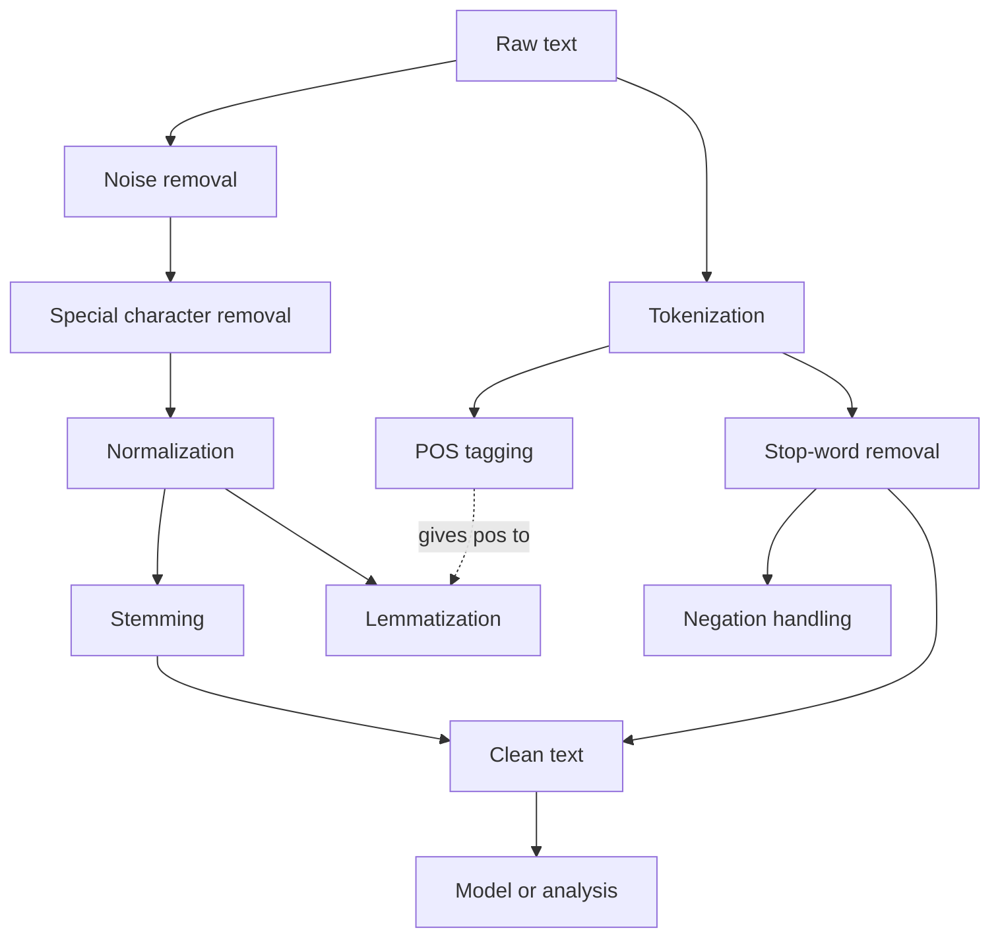
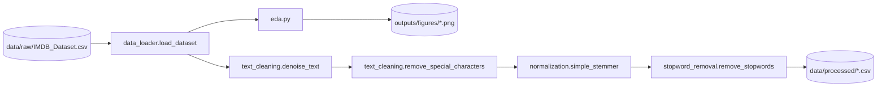
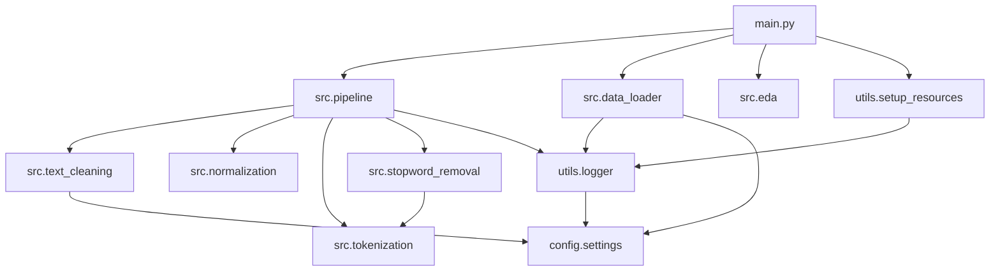
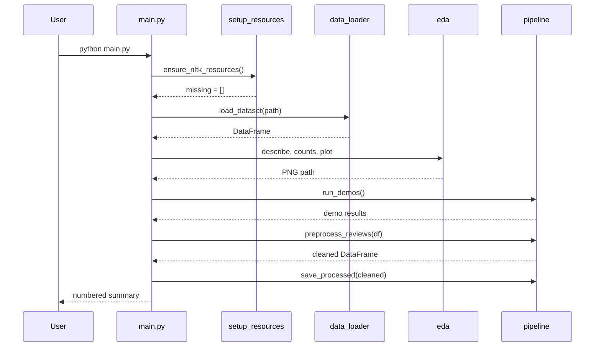

# Knowledge Guide: Text Preprocessing with NLTK

This guide explains what each part of the code does and why it is necessary. Read it together with the code. Each function docstring has a "Why:" line that points to a section here.

**NOTE:** To see the diagrams in VS Code, install the extension **Markdown Preview Mermaid Support**. GitHub shows the diagrams automatically.

---

## Overview

Computers cannot use raw review text directly. Raw text contains HTML tags, punctuation, many forms of one word, and many common words with little meaning. Text preprocessing removes this noise and makes the words uniform. The result is a smaller, cleaner text that a classifier or a language model can use better. This project applies these steps to 50,000 IMDB movie reviews with the `nltk` library.

**Role in Generative AI:** NLTK does not generate text. It cleans and structures text before a model uses it. It can also analyze model outputs, for example keyword frequency or repetition.

---

## Concept Map

This diagram shows how the concepts of text preprocessing relate to each other (theory level).



---

## System Workflow

This diagram shows how the data moves from `data/raw` through the `src` modules to the outputs.



---

## Module Dependency Graph

This diagram shows which module imports which module. An arrow means "imports".



The layers are: `config` → `utils` → `src` → `main.py`. A lower layer never imports a higher layer. This rule prevents circular imports.

---

## Call Sequence

This diagram shows the function calls of one full run (`python main.py`).



---

## Concept Sections

### 0. Supporting Code

**Where in code:** `utils/logger.py` → `get_logger()`; `utils/setup_resources.py` → `ensure_nltk_resources()`; `config/settings.py`
**Called by:** all modules, `main.py` | **Calls:** `logging`, `nltk.download()`

**What it does (1–3 sentences):**
`settings.py` keeps all paths and constants. `get_logger()` gives each module the same log format. `ensure_nltk_resources()` downloads the NLTK data files that are missing.

**Why it is necessary (1–3 sentences):**
`pip install nltk` installs only the code. The stop-word lists, the tokenizer model, WordNet and the tagger model are separate data files. Without them, NLTK functions stop with a `LookupError`.

**Theory:**
- NLTK keeps data in a folder named `nltk_data`.
- `nltk.data.find()` looks for a resource in that folder.
- `nltk.download()` gets a resource from the NLTK data server.
- The function checks first and downloads only when necessary. So a second run does not use the network.

| Resource | Used by | Purpose |
|---|---|---|
| `stopwords` | `get_stopword_list()` | Stop-word lists for many languages |
| `punkt`, `punkt_tab` | `tokenize()` | Tokenizer model. NLTK 3.9 and later use `punkt_tab`. |
| `wordnet` | `lemmatize_word()` | English dictionary for lemmas |
| `averaged_perceptron_tagger`, `..._eng` | `pos_tag_tokens()` | POS tagger model. NLTK 3.9 and later use `_eng`. |

**Worked example:**
First run → 6 resources missing → 6 downloads → `All NLTK resources are ready.`
Second run → 0 resources missing → 0 downloads.

**Code walkthrough:**
| Line / statement | What it does | Why |
|---|---|---|
| `nltk.data.find(candidate)` | Looks for the resource on disk | To skip downloads that are not necessary |
| `nltk.download(resource, quiet=True)` | Downloads one resource | To get the missing data file |
| `missing.append(resource)` | Records a failed download | To give a clear error, not a stack trace |

**Common mistakes:**
- **CAUTION:** Do not call `nltk.download()` at the top of a module. Each import then contacts the server.
- **CAUTION:** Old tutorials download only `punkt`. NLTK 3.9 and later also need `punkt_tab`.

**Related concepts:** [7. Tokenization](#7-tokenization), [9. Stop-Word Removal](#9-stop-word-removal).

---

### 1. Loading the Dataset

**Where in code:** `src/data_loader.py` → `load_dataset()`, `is_placeholder_data()`, `get_review()`
**Called by:** `main.stage_load()` | **Calls:** `config.settings.validate_settings()`, `pandas.read_csv()`

**What it does (1–3 sentences):**
The function reads the CSV file into a `pandas` DataFrame with two columns: `review` and `sentiment`. It checks that the file and the columns exist. It writes a WARNING when the data is placeholder data.

**Why it is necessary (1–3 sentences):**
All other steps work on the DataFrame. A clear check at the start gives a clear error message. Without the check, an error occurs later and is difficult to understand.

**Theory:**
- A CSV file keeps a table as plain text. A comma separates the columns.
- A review can contain commas. So the CSV puts such a review between double quotes.
- `pd.read_csv()` reads the quotes correctly and makes one row per review.
- The IMDB dataset is a **binary sentiment classification** dataset. Each review has one of two labels.

**Worked example:**
Input file (2 rows):
```
review,sentiment
"A wonderful little production. <br /><br />The filming...",positive
"Basically there's a family where a little boy...",negative
```
Process: `pd.read_csv()`.
Output: a DataFrame with shape `(2, 2)`.

**Code walkthrough:**
| Line / statement | What it does | Why |
|---|---|---|
| `validate_settings(path)` | Raises `FileNotFoundError` if the file is missing | To give a clear action to the user |
| `df = pd.read_csv(path)` | Reads the CSV into a DataFrame | Notebook: `df = pd.read_csv('IMDB_Dataset.csv')` |
| `missing = {TEXT_COLUMN, LABEL_COLUMN} - set(df.columns)` | Finds missing columns | To stop early with a clear message |
| `if is_placeholder_data(...)` | Checks for the marker file | To warn that results are not real |
| `df.head(sample_size)` | Keeps the first N rows | To make test runs fast |

**Common mistakes:**
- **CAUTION:** Do not use results from the placeholder data. The 20 reviews are made up.
- **CAUTION:** If you replace the CSV, delete the marker file too. If you do not, the WARNING stays.

**Related concepts:** [2. Exploratory Data Analysis](#2-exploratory-data-analysis).

---

### 2. Exploratory Data Analysis

**Where in code:** `src/eda.py` → `describe_dataset()`, `sentiment_counts()`, `plot_sentiment_distribution()`
**Called by:** `main.stage_eda()` | **Calls:** `df.describe()`, `value_counts()`, `seaborn.barplot()`

**What it does (1–3 sentences):**
The module shows the count, the number of unique values, the most frequent value and its frequency for each column. It counts the reviews per sentiment. It draws a bar chart of the two counts.

**Why it is necessary (1–3 sentences):**
You must know the data before you clean it. The class balance tells you if a model can learn both classes equally. A balanced dataset makes accuracy a fair measure.

**Theory:**
- `describe()` on text columns gives: `count`, `unique`, `top`, `freq`.
- If `unique` < `count`, the dataset has duplicate rows. The real dataset has 49,582 unique reviews in 50,000 rows.
- The class ratio shows the balance:

$$\text{balance ratio} = \frac{n_{\text{minority}}}{n_{\text{majority}}}$$

| Symbol | Meaning |
|---|---|
| $n_{\text{minority}}$ | Number of reviews in the smaller class |
| $n_{\text{majority}}$ | Number of reviews in the larger class |

- A ratio of 1.0 means a perfectly balanced dataset.

**Worked example:**
Input: the real dataset. Process: `value_counts()`. Output: `positive 25000`, `negative 25000`. Ratio = 25000 / 25000 = 1.0. The dataset is balanced.

**Code walkthrough:**
| Line / statement | What it does | Why |
|---|---|---|
| `df[LABEL_COLUMN].value_counts()` | Counts each label | Notebook: `df['sentiment'].value_counts()` |
| `matplotlib.use("Agg")` | Selects a backend with no window | To save charts on any computer |
| `sns.barplot(x=..., y=..., hue=...)` | Draws one bar per label | Notebook code, unchanged |
| `fig.savefig(save_path)` | Saves the chart as PNG | A script has no inline plot area |

**Common mistakes:**
- **CAUTION:** Do not skip EDA. An unbalanced dataset needs different metrics, for example the F1 score.

**Related concepts:** [1. Loading the Dataset](#1-loading-the-dataset).

---

### 3. Noise Removal

**Where in code:** `src/text_cleaning.py` → `strip_html()`, `remove_between_square_brackets()`, `denoise_text()`
**Called by:** `src.pipeline.preprocess_reviews()`, `src.pipeline.run_demos()` | **Calls:** `BeautifulSoup`, `str.replace()`

**What it does (1–3 sentences):**
`strip_html()` removes HTML tags and keeps the visible text. `remove_between_square_brackets()` removes the characters `[` and `]` but keeps the text inside them. `denoise_text()` runs the two functions in this order.

**Why it is necessary (1–3 sentences):**
The reviews come from a web site. Many reviews contain `<br />` tags. These tags are not words, and they add false tokens such as `br`.

**Theory:**
- **Noise** is text that has no value for the task. Examples: HTML and XML markup, file headers and footers, metadata.
- HTML is a tree of tags. `BeautifulSoup` reads the tree with a parser (`"html.parser"`).
- `soup.get_text()` collects only the text nodes of the tree. It drops all tags.
- A regular expression can also remove tags, but it fails on nested or broken HTML. A parser is safer.

**Worked example:**
| Input | Function | Output |
|---|---|---|
| `<h1>This is a test heading.</h1><p>Starting a paragraph here...</p>` | `strip_html()` | `This is a test heading.` / `Starting a paragraph here...` |
| `I bought [apple, banana, orange] yesterday.` | `remove_between_square_brackets()` | `I bought apple, banana, orange yesterday.` |

**Code walkthrough:**
| Line / statement | What it does | Why |
|---|---|---|
| `BeautifulSoup(text, "html.parser")` | Parses the text as HTML | `html.parser` is in the Python standard library. No extra install. |
| `soup.get_text()` | Returns only the visible text | To drop the tags |
| `text.replace('[', '')` | Removes each `[` | To keep the words in the brackets |
| `# return re.sub(r'\[[^]]*\]', '', text)` | Alternative (not used) | It removes the brackets **and** the text inside them |

**Common mistakes:**
- **CAUTION:** `strip_html()` keeps the newline characters between HTML blocks. Later steps treat newlines as whitespace, so this is not a problem.
- **CAUTION:** Do not use the regular-expression alternative if the text in brackets has meaning.

**Related concepts:** [4. Special Character Removal](#4-special-character-removal).

---

### 4. Special Character Removal

**Where in code:** `src/text_cleaning.py` → `remove_special_characters()`
**Called by:** `src.pipeline.preprocess_reviews()`, `src.pipeline.run_demos()` | **Calls:** `re.sub()` (pre-compiled)

**What it does (1–3 sentences):**
The function removes each character that is not a letter, a digit or whitespace. Punctuation and symbols such as `!`, `?`, `'`, `&` disappear.

**Why it is necessary (1–3 sentences):**
Punctuation makes different tokens for one word, for example `movie`, `movie.` and `movie!`. The removal makes these tokens the same. It also reduces the vocabulary size.

**Theory:**
The pattern is `[^a-zA-Z0-9\s]`.

| Part | Meaning |
|---|---|
| `[ ... ]` | A character class: one character from the set |
| `^` (first in the class) | NOT: any character that is not in the set |
| `a-z` | Lowercase letters |
| `A-Z` | Uppercase letters |
| `0-9` | Digits |
| `\s` | Whitespace: space, tab, newline |

`re.sub(pattern, '', text)` replaces each match with an empty string.

**Worked example:**
Input: `Hi There! How are you?` → Process: remove `!` and `?` → Output: `Hi There How are you`.
Input: `I didn't enjoy it.` → Output: `I didnt enjoy it`.

**Code walkthrough:**
| Line / statement | What it does | Why |
|---|---|---|
| `re.compile(SPECIAL_CHAR_PATTERN)` | Compiles the pattern one time | It is faster on 50,000 reviews |
| `_SPECIAL_CHAR_REGEX.sub("", text)` | Removes each match | Notebook: `re.sub(pattern, '', text)` |

**Common mistakes:**
- **CAUTION:** The pattern also removes accented letters, for example `é` in `café` becomes `caf`. For non-English text, change the pattern.
- **CAUTION:** The apostrophe disappears. So `didn't` becomes `didnt`. The stop-word step then does not see `didn't`. See [9. Stop-Word Removal](#9-stop-word-removal).

**Related concepts:** [3. Noise Removal](#3-noise-removal), [9. Stop-Word Removal](#9-stop-word-removal).

---

### 5. Lemmatization

**Where in code:** `src/normalization.py` → `lemmatize_word()`
**Called by:** `src.pipeline.run_demos()` (demo only) | **Calls:** `WordNetLemmatizer.lemmatize()`

**What it does (1–3 sentences):**
The function changes a word to its **lemma**, the dictionary form. It needs the part of speech of the word. For example, `better` as an adjective becomes `good`.

**Why it is necessary (1–3 sentences):**
One meaning can have many word forms: `am`, `is`, `are`, `was` all have the lemma `be`. Lemmatization joins these forms. The result is always a real word, which a person can read.

**Theory:**
1. The lemmatizer receives a word and a POS code.
2. It looks for the word in a WordNet **exception list** for that POS. Irregular forms are in this list (`better` → `good`, `went` → `go`).
3. If the word is not in the list, it tries **detachment rules** for that POS. For nouns, one rule changes `-ies` to `-y`.
4. It returns the first candidate that is in the WordNet dictionary.
5. If no candidate exists, it returns the word unchanged.

| POS code | Meaning |
|---|---|
| `n` | noun (default) |
| `v` | verb |
| `a` | adjective |
| `r` | adverb |
| `s` | satellite adjective |

**Worked example:**
| Input | POS | Output |
|---|---|---|
| `better` | `a` | `good` |
| `better` | `n` (default) | `better` |
| `running` | `v` | `run` |
| `studies` | `n` | `study` |

**Code walkthrough:**
| Line / statement | What it does | Why |
|---|---|---|
| `_lemmatizer = WordNetLemmatizer()` | Creates the lemmatizer one time | It loads WordNet on first use |
| `_lemmatizer.lemmatize(word, pos=pos)` | Returns the lemma | Notebook: `lemmatizer.lemmatize("better", pos="a")` |

**Common mistakes:**
- **CAUTION:** Without the correct `pos`, the lemmatizer treats each word as a noun. Then most verbs stay unchanged. Use [8. POS Tagging](#8-part-of-speech-tagging) to get the POS.
- **NOTE:** The notebook does not apply lemmatization to the dataset. It uses stemming. See [6. Stemming](#6-stemming) for the comparison.

**Related concepts:** [6. Stemming](#6-stemming), [8. Part-of-Speech Tagging](#8-part-of-speech-tagging).

---

### 6. Stemming

**Where in code:** `src/normalization.py` → `simple_stemmer()`
**Called by:** `src.pipeline.preprocess_reviews()`, `src.pipeline.run_demos()` | **Calls:** `PorterStemmer.stem()`

**What it does (1–3 sentences):**
The function splits the text at whitespace. It reduces each word to a **stem** with the Porter algorithm. It joins the stems with single spaces and returns lowercase text.

**Why it is necessary (1–3 sentences):**
Stemming reduces the number of different words (the dimensionality). `like`, `likes` and `liked` all become `like`. A model then learns one feature, not three.

**Theory:**
The Porter stemmer (Martin Porter, 1980) removes suffixes with fixed rules. It uses no dictionary. Each word has the form:

$$[C](VC)^{m}[V]$$

| Symbol | Meaning |
|---|---|
| $C$ | A sequence of one or more consonants |
| $V$ | A sequence of one or more vowels |
| $m$ | The **measure**: how many times $VC$ repeats |
| $[\,]$ | An optional part |

Many rules apply only if $m$ is larger than a value. This rule stops the algorithm from cutting short words too much. The algorithm has 5 steps. Step 1a is an example:

| Rule | Example |
|---|---|
| `SSES` → `SS` | `caresses` → `caress` |
| `IES` → `I` | `ponies` → `poni` |
| `SS` → `SS` | `caress` → `caress` |
| `S` → (nothing) | `likes` → `like`, `goes` → `goe` |

**Worked example:**
Input: `He likes lemons bananas and oranges. He goes to market.`

| Word | Stem | Reason |
|---|---|---|
| `He` | `he` | NLTK makes the word lowercase |
| `likes` | `like` | Rule `S` → (nothing) |
| `lemons` | `lemon` | Rule `S` → (nothing) |
| `oranges.` | `oranges.` | The word ends in `.`, so no suffix rule matches |
| `goes` | `goe` | Rule `S` → (nothing). The result is not a real word. |

Output: `he like lemon banana and oranges. he goe to market.`

**Stemming compared with lemmatization:**
| Property | Stemming | Lemmatization |
|---|---|---|
| Method | Fixed suffix rules | Dictionary (WordNet) and rules |
| Result | Can be a non-word (`goe`, `movi`) | Always a real word |
| Needs POS | No | Yes, for good results |
| Speed | Fast | Slower |
| `better` | `better` | `good` (with `pos="a"`) |

**Code walkthrough:**
| Line / statement | What it does | Why |
|---|---|---|
| `_stemmer = PorterStemmer()` | Creates the stemmer one time | The notebook made one per review. The output is the same. |
| `text.split()` | Splits at whitespace | Simple and fast. Punctuation stays on the word. |
| `_stemmer.stem(word)` | Returns the stem in lowercase | The Porter rules |
| `' '.join([...])` | Joins the stems | To return one string |

**Common mistakes:**
- **CAUTION:** `split()` does not separate punctuation. In the pipeline this is not a problem, because step 4 removes the punctuation first.
- **CAUTION:** Stems such as `thi` (from `this`) and `wa` (from `was`) are no longer stop words. See [10. The Full Preprocessing Pipeline](#10-the-full-preprocessing-pipeline).

**Related concepts:** [5. Lemmatization](#5-lemmatization), [10. The Full Preprocessing Pipeline](#10-the-full-preprocessing-pipeline).

---

### 7. Tokenization

**Where in code:** `src/tokenization.py` → `tokenize()`
**Called by:** `src.stopword_removal.remove_stopwords()`, `src.pipeline.run_demos()` | **Calls:** `nltk.tokenize.word_tokenize()`

**What it does (1–3 sentences):**
The function splits text into **tokens**: words, numbers and punctuation marks. Each punctuation mark becomes a separate token.

**Why it is necessary (1–3 sentences):**
Most NLP steps work on single words, not on a long string. Stop-word removal, POS tagging and counting all need tokens. Language models also start with tokenization.

**Theory:**
`word_tokenize()` works in two stages:
1. The **Punkt** sentence tokenizer splits the text into sentences. Punkt is a trained model. It knows that the `.` in `Dr.` does not end a sentence.
2. The **Treebank** word tokenizer splits each sentence into tokens with regular expressions. It separates punctuation and splits contractions: `don't` → `do`, `n't`.

**Worked example:**
Input: `I enjoy playing football in the rain.`
Output: `['I', 'enjoy', 'playing', 'football', 'in', 'the', 'rain', '.']`

Compare with `str.split()`: `['I', 'enjoy', 'playing', 'football', 'in', 'the', 'rain.']`. Here the period stays on `rain.`.

**Code walkthrough:**
| Line / statement | What it does | Why |
|---|---|---|
| `word_tokenize(text)` | Returns a list of tokens | Notebook: `tokens = word_tokenize(...)` |

**Common mistakes:**
- **CAUTION:** `word_tokenize()` needs the `punkt_tab` resource. If it is missing, you get a `LookupError`. Run `python -m utils.setup_resources`.
- **NOTE:** Large language models use **subword** tokenizers (for example BPE). They split rare words into smaller parts. NLTK tokens are whole words.

**Related concepts:** [8. Part-of-Speech Tagging](#8-part-of-speech-tagging), [9. Stop-Word Removal](#9-stop-word-removal).

---

### 8. Part-of-Speech Tagging

**Where in code:** `src/tokenization.py` → `pos_tag_tokens()`
**Called by:** `src.pipeline.run_demos()` (demo only) | **Calls:** `nltk.pos_tag()`

**What it does (1–3 sentences):**
The function gives each token a **POS tag**: a label for its word class. The tags come from the Penn Treebank tag set.

**Why it is necessary (1–3 sentences):**
One word form can have different meanings. `book` can be a noun or a verb. The POS tag removes this ambiguity, and the lemmatizer needs it.

**Theory:**
NLTK uses an **averaged perceptron** tagger. For each token, the tagger:
1. Collects **features**, for example the word, its suffix, the previous word and the previous tag.
2. Calculates a score for each possible tag.
3. Selects the tag with the highest score.

$$\hat{t} = \arg\max_{t} \sum_{f \in F} w_{f,t}$$

| Symbol | Meaning |
|---|---|
| $\hat{t}$ | The selected tag |
| $t$ | One possible tag |
| $F$ | The set of features of the token |
| $w_{f,t}$ | The learned weight of feature $f$ for tag $t$ |

"Averaged" means that the final weights are the average of the weights over all training steps. This makes the model more stable.

**Worked example:**
| Token | Tag | Meaning |
|---|---|---|
| `I` | `PRP` | Personal pronoun |
| `enjoy` | `VBP` | Verb, present, not 3rd person singular |
| `playing` | `VBG` | Verb, -ing form |
| `football` | `NN` | Noun, singular |
| `in` | `IN` | Preposition |
| `the` | `DT` | Determiner |
| `rain` | `NN` | Noun, singular |
| `.` | `.` | Sentence-final punctuation |

**Code walkthrough:**
| Line / statement | What it does | Why |
|---|---|---|
| `nltk.pos_tag(tokens)` | Returns `(token, tag)` pairs | Notebook: `tagged = nltk.pos_tag(tokens)` |

**Common mistakes:**
- **CAUTION:** Penn Treebank tags (`NN`, `VBG`) are not the same as WordNet POS codes (`n`, `v`). To use a tag with the lemmatizer, convert it first: `NN*` → `n`, `VB*` → `v`, `JJ*` → `a`, `RB*` → `r`.
- **CAUTION:** Tag tokens before you remove stop words or punctuation. The tagger uses the context.

**Related concepts:** [5. Lemmatization](#5-lemmatization), [7. Tokenization](#7-tokenization).

---

### 9. Stop-Word Removal

**Where in code:** `src/stopword_removal.py` → `get_stopword_list()`, `build_updated_stopword_list()`, `get_updated_stopword_list()`, `remove_stopwords()`
**Called by:** `src.pipeline.preprocess_reviews()`, `src.pipeline.run_demos()` | **Calls:** `nltk.corpus.stopwords.words()`, `src.tokenization.tokenize()`

**What it does (1–3 sentences):**
The module gets the NLTK English stop-word list. It removes `not` and each word that ends in `n't` from that list. Then `remove_stopwords()` tokenizes a text and drops each token that is in the updated list.

**Why it is necessary (1–3 sentences):**
Stop words such as `the`, `a`, `is` occur in almost every review. They add little information but many tokens. To remove them makes the data smaller and moves the focus to words with meaning.

**Theory:**
- Word frequencies in natural language follow **Zipf's law**. A few words occur very often, and most words occur rarely:

$$f(r) \propto \frac{1}{r}$$

| Symbol | Meaning |
|---|---|
| $r$ | The rank of a word (1 = the most frequent word) |
| $f(r)$ | The frequency of the word with rank $r$ |
| $\propto$ | "is proportional to" |

- The most frequent words are mostly function words. Stop-word lists contain these words.
- **Negation handling:** the NLTK list contains `not`, `don't`, `didn't` and similar words. For sentiment, these words are important. `not a good movie` without `not` becomes `a good movie`. That reverses the sentiment. So the code keeps them.

**Worked example:**
Input: `The movie was not that great`

| Token | Lowercase in updated list? | Result |
|---|---|---|
| `The` | Yes (`the`) | Removed |
| `movie` | No | Kept |
| `was` | Yes | Removed |
| `not` | No (kept on purpose) | Kept |
| `that` | Yes | Removed |
| `great` | No | Kept |

Output: `movie not great`

**Code walkthrough:**
| Line / statement | What it does | Why |
|---|---|---|
| `stopwords.words('english')` | Returns the full English list | Notebook: `stopword_list = ...` |
| `if word == 'not' or word.endswith("n't"): pass` | Skips negation words | To keep the sentiment |
| `@lru_cache(maxsize=1)` | Builds the list one time | Replaces the notebook global variable |
| `tokens = tokenize(text)` | Splits the text into tokens | Stop words are single tokens |
| `token.lower() not in stop_set` | Compares the lowercase form | `The` and `the` are the same stop word |
| `' '.join(filtered_tokens)` | Joins the kept tokens | To return one string |

**Common mistakes:**
- **CAUTION:** The updated list still contains short forms such as `didn`, `isn`, `wasn` (without `'t`). The pipeline removes apostrophes in step 4, so `didn't` becomes `didnt`. `didnt` is not in the list, so it stays. The negation survives, but as `didnt`, not as `not`.
- **CAUTION:** The updated list still contains `no` and `nor`. These words are also negations. Remove them from the list if your task needs them.
- **CAUTION:** For a language model or for translation, do not remove stop words. Those models need the full grammar.

**Related concepts:** [7. Tokenization](#7-tokenization), [10. The Full Preprocessing Pipeline](#10-the-full-preprocessing-pipeline).

---

### 10. The Full Preprocessing Pipeline

**Where in code:** `src/pipeline.py` → `PREPROCESSING_STEPS`, `preprocess_reviews()`, `save_processed()`, `run_demos()`
**Called by:** `main.stage_preprocess()`, `main.stage_demo()` | **Calls:** the functions of sections 3, 4, 6 and 9

**What it does (1–3 sentences):**
`preprocess_reviews()` applies 4 steps to each review in a fixed order. It returns a new DataFrame. `save_processed()` writes the result to `data/processed/`.

**Why it is necessary (1–3 sentences):**
The order of the steps changes the result. A fixed list of steps makes the order clear and easy to change. A saved file lets the next tutorial start from clean data.

**Theory:**
The steps, in the notebook order:

| # | Step | Input example | Output example |
|---|---|---|---|
| 1 | `denoise_text` | `This was not good.<br /><br />I didn't like it.` | `This was not good.I didn't like it.` |
| 2 | `remove_special_characters` | (output of 1) | `This was not goodI didnt like it` |
| 3 | `simple_stemmer` | (output of 2) | `thi wa not goodi didnt like it` |
| 4 | `remove_stopwords` | (output of 3) | `thi wa not goodi didnt like` |

This example shows three effects of the order:
- `<br />` between sentences leaves no space, so `good.I` joins into one word `goodi`.
- Step 3 changes `this` to `thi` and `was` to `wa`. These stems are not in the stop-word list, so step 4 keeps them. The notebook output shows the same effect: `thought thi wa wonder way`.
- `didn't` becomes `didnt` in step 2, so the negation survives step 4.

**Worked example (real notebook output):**
Input review 2: `I thought this was a wonderful way to spend time on a too hot summer weekend...`
Output review 2: `thought thi wa wonder way spend time hot summe...`

**Code walkthrough:**
| Line / statement | What it does | Why |
|---|---|---|
| `PREPROCESSING_STEPS = [...]` | Lists the steps in order | One place to read or change the order |
| `result = df.copy()` | Copies the DataFrame | The input stays unchanged |
| `result[text_column].apply(step_function)` | Runs one step on each review | Notebook: `df['review'] = df['review'].apply(...)` |
| `time.perf_counter()` | Measures each step | Shows that stemming is the slowest step |
| `df.to_csv(path, index=False)` | Saves the result | For later tutorials |

**Common mistakes:**
- **CAUTION:** To change the order changes the output. Example: stop-word removal before stemming removes `this` and `was` correctly.
- **NOTE:** An experiment: in `PREPROCESSING_STEPS`, move `remove_stopwords` above `simple_stemmer`. Run `python main.py --step preprocess`. Compare the first rows.

**Related concepts:** all sections 3 to 9.

---

## Concept-to-Code Index

| Concept | File | Function | Section |
|---|---|---|---|
| NLTK data download | `utils/setup_resources.py` | `ensure_nltk_resources()` | [0](#0-supporting-code) |
| Logging | `utils/logger.py` | `get_logger()` | [0](#0-supporting-code) |
| Dataset loading | `src/data_loader.py` | `load_dataset()` | [1](#1-loading-the-dataset) |
| Placeholder check | `src/data_loader.py` | `is_placeholder_data()` | [1](#1-loading-the-dataset) |
| Summary statistics | `src/eda.py` | `describe_dataset()` | [2](#2-exploratory-data-analysis) |
| Class balance | `src/eda.py` | `sentiment_counts()`, `plot_sentiment_distribution()` | [2](#2-exploratory-data-analysis) |
| HTML removal | `src/text_cleaning.py` | `strip_html()` | [3](#3-noise-removal) |
| Bracket removal | `src/text_cleaning.py` | `remove_between_square_brackets()` | [3](#3-noise-removal) |
| Noise removal | `src/text_cleaning.py` | `denoise_text()` | [3](#3-noise-removal) |
| Special characters | `src/text_cleaning.py` | `remove_special_characters()` | [4](#4-special-character-removal) |
| Lemmatization | `src/normalization.py` | `lemmatize_word()` | [5](#5-lemmatization) |
| Stemming | `src/normalization.py` | `simple_stemmer()` | [6](#6-stemming) |
| Tokenization | `src/tokenization.py` | `tokenize()` | [7](#7-tokenization) |
| POS tagging | `src/tokenization.py` | `pos_tag_tokens()` | [8](#8-part-of-speech-tagging) |
| Stop words | `src/stopword_removal.py` | `remove_stopwords()` | [9](#9-stop-word-removal) |
| Negation handling | `src/stopword_removal.py` | `build_updated_stopword_list()` | [9](#9-stop-word-removal) |
| Full pipeline | `src/pipeline.py` | `preprocess_reviews()` | [10](#10-the-full-preprocessing-pipeline) |

---

## Glossary

| Term | Definition |
|---|---|
| Corpus | A large collection of text. NLTK gives many corpora, for example the stop-word lists. |
| DataFrame | A `pandas` table with rows and named columns. |
| EDA (Exploratory Data Analysis) | A first look at a dataset: size, values, and class counts. |
| HTML tag | A markup code in angle brackets, for example `<br />`. It is not part of the visible text. |
| Lemma | The dictionary form of a word. The lemma of "better" (adjective) is "good". |
| Lemmatization | The process that changes a word to its lemma. It uses a dictionary (WordNet). |
| Negation | A word that reverses the meaning, for example "not" or "didn't". |
| NLTK | Natural Language Toolkit. A Python library for work with human language. |
| Noise | Text that has no value for the task, for example HTML tags. |
| POS tag | Part-of-speech tag. A label for the word class, for example `NN` (noun) or `VBG` (verb, -ing form). |
| Regular expression | A pattern that matches a set of strings. Python uses the `re` module for it. |
| Sentiment | The opinion in a text: positive or negative. |
| Special character | A character that is not a letter, a digit or whitespace, for example `!` or `?`. |
| Stem | The part of a word that stays after a rule removes the suffix. The stem of "likes" is "like". |
| Stemming | The process that cuts word endings by fixed rules. It does not use a dictionary. |
| Stop word | A very common word with little meaning, for example "the", "is", "he". |
| Token | One unit of text after tokenization: a word, a number or a punctuation mark. |
| Tokenization | The process that splits text into tokens. |
| Virtual environment | A folder with its own Python and packages, separate from other projects. |
| WordNet | A large English dictionary database that NLTK uses for lemmatization. |

---

## Further Reading

| Source | Topic |
|---|---|
| [NLTK documentation](https://www.nltk.org/) | All NLTK functions in this project |
| [NLTK data](https://www.nltk.org/data.html) | How to install NLTK resources |
| [Beautiful Soup documentation](https://www.crummy.com/software/BeautifulSoup/bs4/doc/) | HTML parsing |
| [Regular Expressions in Python (Real Python)](https://realpython.com/regex-python/) | The link that the notebook cites |
| [Large Movie Review Dataset (Stanford)](http://ai.stanford.edu/~amaas/data/sentiment/) | The dataset source that the notebook cites |
| [Python `re` module](https://docs.python.org/3/library/re.html) | Regular expression syntax |
| [pandas documentation](https://pandas.pydata.org/docs/) | `read_csv`, `apply`, `value_counts` |
